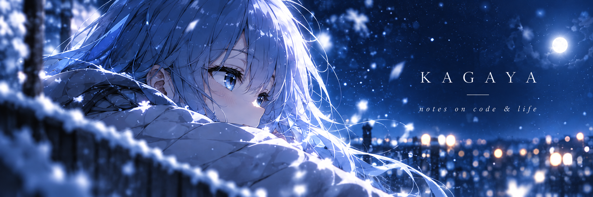

  

  写一点代码，记一些日常。 
  在平凡的生活里，收集闪闪发光的瞬间。

 

### About Me

你好，我是 **Kagaya**。这里是我的小小角落，记录代码、生活和那些值得留下的瞬间。

### Featured

- **[Kagayaの小站](https://kagayakihikari.cn/)** — 记录、表达，以及生活里的点滴。
- **[Thumbnail-based Blur](https://github.com/KagayakiHikari/thumbnail-based-blur)** — 探索基于缩略图的模糊效果。
- **[Open Blog Framework](https://github.com/KagayakiHikari/open-blog-framework)** — 一个基于 Node.js 和 SQLite 的轻量博客框架。

 

<em>Code the things I like, and live a little warmer.</em>

